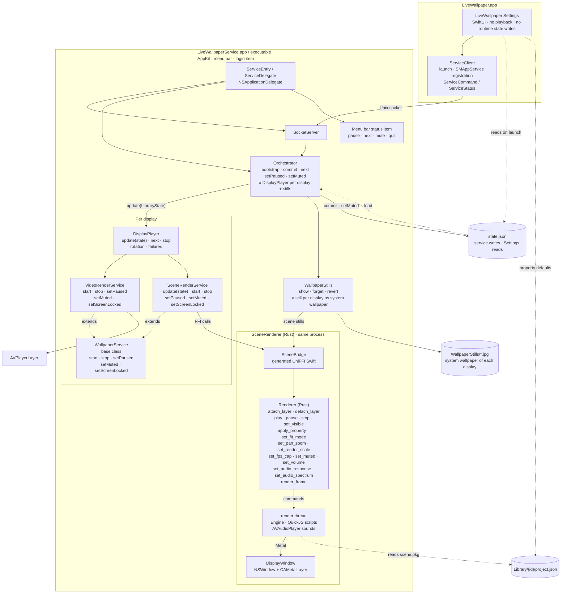

# Architecture

Live Wallpaper is one app bundle with two running processes:

- **LiveWallpaper.app** — the SwiftUI Settings app. It reads the library, edits settings, drives Steam Workshop downloads and sends commands to the service. It never plays a wallpaper and, after the one-time schema migration described below, never writes `state.json`.
- **LiveWallpaperService.app** — the nested AppKit background service at `Contents/Library/LoginItems/`. It draws every display's wallpaper and owns the system wallpaper stills, rotation timers, the menu bar item, the Unix socket and `state.json`.

The Rust/C++ scene renderer is statically linked into the service and accessed in-process through UniFFI. There is no scene-host process, no XPC service and no per-scene subprocess.

## Combined diagram

The outer graph is vertical; the app, playback services and renderer use horizontal layout. This is one diagram rather than separate process, class and Rust diagrams.



## Processes and IPC

Settings starts the nested service with `NSWorkspace.openApplication` when nothing answers on the socket, and registers it as an `SMAppService` login item. The service also enforces a single running instance: if a live service answers on the socket, a second copy exits.

The transport is a Unix domain socket, not NSXPC or launchd:

- Preferred path: `~/Library/Application Support/LiveWallpaper/service.sock`.
- Fallback when the path exceeds `sockaddr_un.sun_path`: `/tmp/lw-<uid>/service.sock`.
- Socket permissions are `0600`.
- Each message is a 4-byte big-endian length followed by JSON for `ServiceEnvelope`.
- The envelope carries a `ServiceCommand` or `ServiceStatus` payload encoded as JSON, so adding a command does not change the framing.
- One connection thread reads commands per client; commands are dispatched on the main actor; connected clients receive status pushes.

NSXPC was not used because launchd would not spawn the ad-hoc-signed nested service (`spawn failed, EX_CONFIG`). The custom socket avoids that requirement.

### State ownership

| File | Owner | Purpose |
|---|---|---|
| `state.json` | Service (normal operation) | Library, playlist, the still's update delay, and per display (`displays`, keyed by the display's UUID): its wallpaper, mute, rotation, scene options and power settings. Settings reads it and sends `.commit`. |
| `agent.json` | Service | The still each display was last given, and the Aerial records older versions left (cleaned up at launch). |
| `WallpaperStills/*.jpg` | Service (`WallpaperStills`) | The still each display shows as its system wallpaper, named after a digest of what it shows. |
| `Library/{id}/project.json` | Workshop import / user library | Scene description read by both Settings and the renderer. |

There is one deliberate exception to “the service writes `state.json`”: when the Settings app upgrades a file of an older schema, `StateStore.loadOrMigrate` copies it to `state.v<schema>-backup.json` and performs the one-time rewrite before connecting to the service. Files before schema 3 hold one wallpaper with its settings for the whole desktop; the upgrade gives it to every display connected at that moment. After that, all commits go through the service.

A display is named by its UUID (`DisplayIdentity`, from `CGDisplayCreateUUIDFromDisplayID`), which stays the same across restarts and reconnecting. A display without a wallpaper in `state.json` keeps whatever system wallpaper it has. Each display's `muted` is changed only through `.setMuted` (the menu bar item mutes every display), never by a commit.

## Service classes

`WallpaperService` is the base class of what draws a wallpaper on one display:

```text
WallpaperService(displayID)
  start(item)
  stop()
  setPaused(Bool)
  setMuted(Bool)
  setScreenLocked(Bool)
  revealSystemWallpaper()
```

`VideoRenderService` extends it with an AVPlayer window (`AVPlayerLayer`) on its display.

`SceneRenderService` also extends it, with a `Renderer` of its own, and adds:

```text
update(LibraryState)
```

It reads its display's settings (`DisplayConfig`), pushes only changed values to the renderer, and applies the battery rule itself (on battery or in Low Power Mode: pause, or lower FPS and render scale). While the screen is locked the renderer draws nothing and its sounds stop. The pointer drives parallax relative to its own display. When a playing scene has audio response on, it also runs `SystemAudioTap` (a Core Audio process tap) and hands the spectrum to the renderer.

Both render services draw into a `DisplayWindow`: one desktop-level window on their display, kept for as long as the display stays connected. A change of the screen parameters (resolution, arrangement, the menu bar's background) only moves or resizes the window; `SceneRenderService` then attaches the layer again when its size changed.

`DisplayPlayer` owns one service of each kind for one display and decides which one shows its current item: the display's wallpaper, or, while the display rotates, the playlist in turn from there. A rotating display skips items that cannot play; any other display then shows nothing live and reports why (`DisplayStatus.error`). The windows are `.canJoinAllSpaces`, so they work the same with and without separate Spaces per display.

`WallpaperStills` is separate from the playback hierarchy. The menu bar's background, Mission Control and the lock screen show the system wallpaper, never our windows, so it sets every display's system wallpaper to a still of the live wallpaper at that display's pixel size: for a scene, a second, off-screen `Renderer` with the live scene's framing and properties; for a video, a frame filled and centred like the player's layer. A still is made only when the wallpaper, a display or the scene's framing changes, after the update delay set in Settings (`LibraryState.stillDelay`, 2 s by default, so a slider drag ends in one still), and it stays when the service quits. Displays that show the same wallpaper at the same size share one file and one render. A display whose wallpaper is taken away (or deleted from the library) gets macOS's default wallpaper back (`/System/Library/CoreServices/DefaultDesktop.heic`). `agent.json` remembers each display's last still, so a display that is not connected keeps its file. The menu bar refreshes its copy of the wallpaper only when the wallpaper is drawn, which never happens behind the opaque live windows, so after setting a still the display's window lets it through at 1% for half a second (`DisplayWindow.revealSystemWallpaper`). `LegacyLockScreen` puts back Apple's Aerial files that older versions swapped for their lock-screen video and deletes their lock-screen leftovers at launch.

`Orchestrator` owns a `DisplayPlayer` for every connected display that has a wallpaper, and one `WallpaperStills`. It follows displays as they come and go, keeps each display's still in step with what it shows, and is the normal writer of `state.json`.

`ServiceDelegate` owns the socket server, the menu bar item and the orchestrator. Settings has no playback classes and never imports `SceneBridge`. Its Home page shows the displays as arranged in System Settings (`DisplayPicker`, from `NSScreen` frames); clicking one picks the display the library and the inspector work on. A display's tile shows its system wallpaper, which the service reports per display (`DisplayStatus.systemWallpaper`, with the item it is a still of), so the tile looks like the display itself.

## Scene renderer

`SceneRenderer/` is our own MIT renderer (Rust + Metal). `scripts/build-scene-renderer.sh` builds `libscene_renderer.a` and runs `uniffi-bindgen` to generate:

- `Sources/SceneBridge/SceneRenderer.swift` — generated Swift API; do not hand-edit.
- `Sources/SceneBridge/FFI/scene_rendererFFI.h` and `module.modulemap` — the SwiftPM system-library target `SceneRendererFFI`.

The exported type is `Renderer` in `SceneRenderer/src/api.rs`. Every call is a message to the renderer's own thread, which owns the Metal device, the scene and its textures; calls never block on drawing (except `render_frame`, which returns pixels). Inside:

- `vfs`, `tex`, `scene`: the package, textures and `scene.json`.
- `shader`: Wallpaper Engine shaders to MSL through naga.
- `engine`: the frame graph (layers, effects, particles, puppets, text, bloom, fit modes).
- `script` + `script_prelude.js`: SceneScript on QuickJS (`rquickjs`).
- `sound`: sound objects through AVAudioPlayer.

`VideoRenderService` uses AVPlayer, not the renderer.

## Scene options and state

Each display's `DisplayConfig` stores:

- `sceneOptions: [String: SceneOptions]` — per-scene fit, zoom, pan, render scale, FPS override, volume, audio response and property overrides, keyed by the Swift item UUID.
- `sceneFPS` and `power: PowerOptions` — the display's scene frame rate, frame-rate cap, battery mode, battery render scale/FPS, `skipRepeatedFrames` and `renderOnlyOnChange`.

`SceneRenderService.update` compares the new values with the last pushed values and calls only the changed renderer methods.

| UI / model | Renderer call |
|---|---|
| Fit | `set_fit_mode` |
| Zoom, pan | `set_pan_zoom` |
| FPS, frame-rate cap, battery FPS | `set_fps_cap` (the smallest that applies) |
| Render scale, battery render scale | `set_render_scale` |
| Volume / mute | `set_volume` / `set_muted` |
| Audio response | `set_audio_response`, plus `set_audio_spectrum` from `SystemAudioTap` |
| Scene properties | `apply_property` (JSON value) |
| Battery rule "Pause", app pause | `pause` / `play` |
| Skip repeated frames, update only when changed | nothing: a scene in which nothing moves is never redrawn |

Settings reparses `Library/{id}/project.json` for the property editor (`SceneProperty.load`); it supports bool, slider, color, text and combo.

Known mismatches:

- `antialiasing` is stored in `SceneOptions` but is not applied or exposed in the current Settings UI.

## Build and packaging

Build order:

```sh
./build.sh
```

`build.sh` runs `scripts/build-scene-renderer.sh` first (Rust stable, `UNIVERSAL=1` merges an x86_64 slice with `lipo`), then builds the two Swift products. The renderer is a static library and uses only system frameworks, so nothing is bundled next to the service.

Every part targets macOS 26 and builds against the macOS 26 SDK: `Package.swift` declares `.macOS(.v26)` (tools version 6.2, Swift 5 language mode), both `Resources/Info.plist` files set `LSMinimumSystemVersion` 26.0, and `scripts/macos-sdk.sh` exports `MACOSX_DEPLOYMENT_TARGET=26.0` (for the renderer) and `SDKROOT` (for SwiftPM, rustc and clang). `build.sh`, the renderer build and every CI job use it. It takes the active developer directory's SDK when that is a macOS 26 one, otherwise the newest `MacOSX26.x.sdk` of another Xcode or the Command Line Tools, and fails when there is none. SwiftPM's default swiftbuild build system (Swift 6.4) ignores `SDKROOT`, so for an SDK other than the active default the script adds `--build-system native` to `swift build/test/run` (`LW_SWIFTPM_FLAGS`). The renderer build cleans `SceneRenderer/target` when its stamp shows another deployment target, because cargo does not rebuild for one. `scripts/verify-bundle.sh` checks that both executables are built for macOS 26 with a macOS 26 SDK.

CI uses `macos-26` runners (Xcode 26) for build and release.

`build.sh` assembles the Settings app, nests the service under `Contents/Library/LoginItems/` and signs inner bundles before the outer app. The guards reject SwiftUI or the old in-repo scene engine in the service, the old scene engine in Settings, and any Homebrew load path; `scripts/verify-bundle.sh` also checks that the renderer is linked into the service.

## Limitations

- Scene support is still partial: unsupported shaders, 3D models and lights, and video textures are reported as load warnings.
- The Swift scene property editor covers bool, slider, color, text and combo.
- Antialiasing is stored but not applied.
- Two displays that show the same wallpaper each run their own player or renderer.
- Video playback uses AVPlayer windows, while scenes use the Rust renderer.
- The app is ad-hoc signed and not notarized.

## Licensing

All code, including `SceneRenderer/`, is MIT-licensed under the root `LICENSE`. `SceneRenderer/NOTES.md` records which outside projects informed which parts of the renderer.
