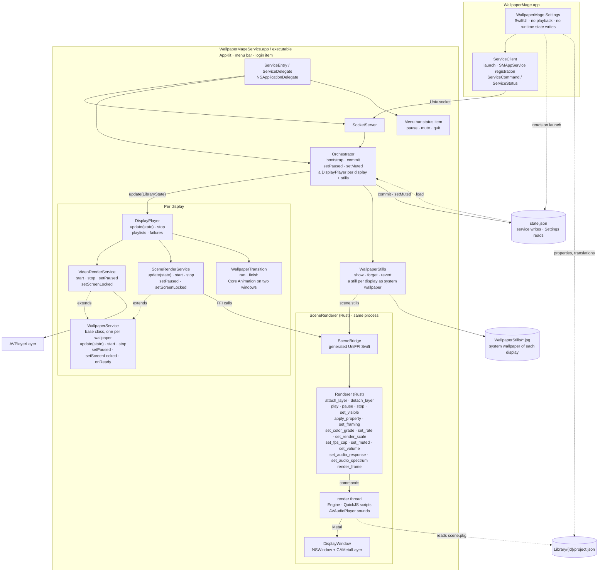

# Architecture

Wallpaper Mage is one app bundle with two running processes:

- **WallpaperMage.app** — the SwiftUI Settings app. It reads the library, edits settings, drives Steam Workshop downloads and sends commands to the service. It never plays a wallpaper and, after the one-time schema migration described below, never writes `state.json`.
- **WallpaperMageService.app** — the nested AppKit background service at `Contents/Library/LoginItems/`. It draws every display's wallpaper and owns the system wallpaper stills, playlist timers and transitions, the menu bar item, the Unix socket and `state.json`.

The Rust/C++ scene renderer is statically linked into the service and accessed in-process through UniFFI. There is no scene-host process, no XPC service and no per-scene subprocess.

## Combined diagram

The outer graph is vertical; the app, playback services and renderer use horizontal layout. This is one diagram rather than separate process, class and Rust diagrams.



## Processes and IPC

Settings starts the nested service with `NSWorkspace.openApplication` when nothing answers on the socket, and registers it as an `SMAppService` login item. The service also enforces a single running instance: if a live service answers on the socket, a second copy exits.

The transport is a Unix domain socket, not NSXPC or launchd:

- Preferred path: `~/Library/Application Support/WallpaperMage/service.sock`.
- Fallback when the path exceeds `sockaddr_un.sun_path`: `/tmp/wm-<uid>/service.sock`.
- Socket permissions are `0600`.
- Each message is a 4-byte big-endian length followed by JSON for `ServiceEnvelope`.
- The envelope carries a `ServiceCommand` or `ServiceStatus` payload encoded as JSON, so adding a command does not change the framing.
- One connection thread reads commands per client; commands are dispatched on the main actor; connected clients receive status pushes.

NSXPC was not used because launchd would not spawn the ad-hoc-signed nested service (`spawn failed, EX_CONFIG`). The custom socket avoids that requirement.

### State ownership

| File | Owner | Purpose |
|---|---|---|
| `state.json` | Service (normal operation) | Library, playlists, the still's update delay, and per display (`displays`, keyed by the display's UUID): its wallpaper or playlist, its wallpaper options and power settings. Settings reads it and sends `.commit`. |
| `agent.json` | Service | The still each display was last given, and the Aerial records older versions left (cleaned up at launch). |
| `WallpaperStills/*.jpg` | Service (`WallpaperStills`) | The still each display shows as its system wallpaper, named after a digest of what it shows. |
| `PlaylistImages/*` | Settings (`PlaylistImage`) | The pictures users chose for their playlists, scaled down to 1200 pixels, each under a new name. |
| `Library/{id}/project.json` | Workshop import / user library | Scene description read by both Settings and the renderer. |

There is one deliberate exception to “the service writes `state.json`”: when the Settings app upgrades a file of an older schema, `StateStore.loadOrMigrate` copies it to `state.v<schema>-backup.json` and performs the one-time rewrite before connecting to the service. Files before schema 3 hold one wallpaper with its settings for the whole desktop; the upgrade gives it to every display connected at that moment. Files before schema 6 hold a single unnamed playlist and a rotation setting per display; the upgrade drops both and keeps each display's wallpaper. After that, all commits go through the service.

A display is named by its UUID (`DisplayIdentity`, from `CGDisplayCreateUUIDFromDisplayID`), which stays the same across restarts and reconnecting. A display without content in `state.json` keeps whatever system wallpaper it has. `LibraryState.muted`, the whole app's mute (the menu bar's Mute Sound and Settings' Mute all wallpapers), is changed only through `.setMuted`, never by a commit.

## Service classes

`WallpaperService` is the base class of what draws one wallpaper on one display:

```text
WallpaperService(displayID)
  update(LibraryState)
  start(item)
  stop()
  setPaused(Bool)
  setScreenLocked(Bool)
  revealSystemWallpaper()
  onReady, onFailure
```

It reads the item's options with `LibraryState.options(for:on:)`: its playlist's while the display plays a playlist that has it, else the display's own (`DisplayConfig`). `onReady` fires once the first frame is drawn (a scene's renderer counts a frame, a video's `AVPlayerLayer` is ready for display), or after a few seconds in any case.

`VideoRenderService` extends it with an AVPlayer window (`AVPlayerLayer`) on its display.

`SceneRenderService` also extends it, with a `Renderer` of its own. It pushes only changed values to the renderer, and applies the battery rule itself (on battery or in Low Power Mode: pause, or lower FPS and render scale). A paused scene still draws its first frame, silently, so its window has a picture. While the screen is locked the renderer draws nothing and its sounds stop. The pointer drives parallax relative to its own display. When a playing scene has audio response on, it also runs `SystemAudioTap` (a Core Audio process tap) and hands the spectrum to the renderer.

Both render services draw into a `DisplayWindow`: one desktop-level window on their display, kept for as long as the display stays connected. A change of the screen parameters (resolution, arrangement, the menu bar's background) only moves or resizes the window; `SceneRenderService` then attaches the layer again when its size changed. The window's content view is a `StageView` holding the view the renderer or player draws into. A window opens transparent, so whatever it replaces stays visible under it, and turns opaque when it is presented.

`DisplayPlayer` shows what its display is set to (`DisplayConfig.content`): a wallpaper, or a playlist's wallpapers one after another, each for the playlist's interval. It makes a new service for every wallpaper it shows: the next one loads in its transparent window above the current one, which keeps playing until the next one is ready and has come in. A playlist's wallpaper comes in with the playlist's transition (`WallpaperTransition`: fade, fade through black, blur, zoom or slide), anything else at once. The transition animates only the two windows' stages with Core Animation (opacity, a sublayer transform, a Gaussian blur filter), so the views the renderer and the player draw into are never touched and the window server does the work; then the new window is presented and the old service stopped. A playlist skips wallpapers that cannot play; a display with a single wallpaper that cannot play shows nothing live and reports why (`DisplayStatus.error`). The windows are `.canJoinAllSpaces`, so they work the same with and without separate Spaces per display.

`WallpaperStills` is separate from the playback hierarchy. The menu bar's background, Mission Control and the lock screen show the system wallpaper, never our windows, so it sets every display's system wallpaper to a still of the live wallpaper at that display's pixel size: for a scene, a second, off-screen `Renderer` with the live scene's framing and properties; for a video, a frame filled and centred like the player's layer. A still is made only when the wallpaper, a display or the scene's framing changes, after the update delay set in Settings (`LibraryState.stillDelay`, 2 s by default, so a slider drag ends in one still), and it stays when the service quits. Displays that show the same wallpaper at the same size share one file and one render. A display whose wallpaper is taken away (or deleted from the library) gets macOS's default wallpaper back (`/System/Library/CoreServices/DefaultDesktop.heic`). `agent.json` remembers each display's last still, so a display that is not connected keeps its file. The menu bar refreshes its copy of the wallpaper only when the wallpaper is drawn, which never happens behind the opaque live windows, so after setting a still the display's window lets it through at 1% for half a second (`DisplayWindow.revealSystemWallpaper`; during a transition, after it). `LegacyLockScreen` puts back Apple's Aerial files that older versions swapped for their lock-screen video and deletes their lock-screen leftovers at launch.

`Orchestrator` owns a `DisplayPlayer` for every connected display that has a wallpaper or a playlist, and one `WallpaperStills`. It follows displays as they come and go, keeps each display's still in step with what it shows, and is the normal writer of `state.json`.

`ServiceDelegate` owns the socket server, the menu bar item and the orchestrator. Settings has no playback classes and never imports `SceneBridge`. Its Home page shows the displays as arranged in System Settings (`DisplayPicker`, from `NSScreen` frames); clicking one picks the display the library and the inspector work on. The library lists the playlists, then the wallpapers (`LibraryEntry.library`), without the kinds its title row's filter buttons hide (`SettingsModel.hiddenLibraryKinds`: playlists, scenes, videos; UI state only); a click puts one on that display, and a checkmark marks the one it shows. A playlist's editor (`PlaylistEditorView`) takes the library's place while it is open, with the settings of the wallpaper selected in it in the inspector. Its edits are committed live; `SettingsModel` keeps the playlist as it was when the editor opened, so Done keeps the edit and every other way out of the editor (Cancel, another page, Settings, quitting) undoes it, after asking when there is something to undo (`leaveEditor`). The window's close button is off while the editor is open. A display's tile shows its system wallpaper, which the service reports per display (`DisplayStatus.systemWallpaper`, with the item it is a still of), so the tile looks like the display itself.

## Scene renderer

`SceneRenderer/` is our own MIT renderer (Rust + Metal). `scripts/build-scene-renderer.sh` builds `libscene_renderer.a` and runs `uniffi-bindgen` to generate:

- `Sources/SceneBridge/SceneRenderer.swift` — generated Swift API; do not hand-edit.
- `Sources/SceneBridge/FFI/scene_rendererFFI.h` and `module.modulemap` — the SwiftPM system-library target `SceneRendererFFI`.

The exported type is `Renderer` in `SceneRenderer/src/api.rs`. Every call is a message to the renderer's own thread, which owns the Metal device, the scene and its textures; calls never block on drawing (except `render_frame`, which returns pixels). Inside:

- `vfs`, `tex`, `scene`: the package, textures and `scene.json`.
- `shader`: Wallpaper Engine shaders to MSL through naga.
- `engine`: the frame graph (layers, effects, particles, puppets, text, bloom, framing, the colour grade); `engine_models` draws 3D models with `model` (meshes), `camera` (perspective, paths, shake) and `light`.
- `particles`: Wallpaper Engine's particle systems on the CPU: `model` (definitions and their defaults), `overrides` (a scene's instance overrides), `sim` (emitters, initializers, children, control points, prewarm), `operators`, `noise` and `geometry` (the vertices the engine's own particle shaders read; `engine` draws them through those shaders).
- `script` + `script_prelude.js`: SceneScript on QuickJS (`rquickjs`).
- `sound`: sound objects through AVAudioPlayer, in Wallpaper Engine's playback modes.

`VideoRenderService` uses AVPlayer, not the renderer.

## Wallpaper options and state

Each display's `DisplayConfig` stores:

- `content: DisplayContent?` (JSON key `wallpaperID` or `playlistID`) — what the display shows: a wallpaper, a playlist or nothing.
- `wallpaperOptions: [String: WallpaperOptions]` (JSON key `sceneOptions`) — per wallpaper the display shows on its own, keyed by the item's UUID: Wallpaper Engine's own options, which every wallpaper has (volume, playback rate, alignment with position/horizontal/vertical/zoom, flip, blurred bars, colour options, image filter, mouse parallax), and for scenes the frame rate, render scale, antialiasing, audio response and the scene's own property values.
- `power: PowerOptions` — the display's battery mode and battery render scale/FPS.

Each `Playlist` in `LibraryState.playlists` stores its name, its wallpapers in order (`items`, each at most once), `wallpaperOptions` of its own for them (used on every display that plays it), how long each wallpaper stays (`intervalValue`/`intervalUnit`, at least 5 seconds), its `transition` and `transitionDuration`, and the file name of its own picture (`image`, in `PlaylistImages/`; without one Settings shows a collage of its first wallpapers' previews).

`LibraryState` also holds `masterVolume` (scales every wallpaper's volume) and `presets` (named sets of a wallpaper's options, per `VideoItem.presetKey`).

The Settings app lists a wallpaper's options the way Wallpaper Engine does (`WallpaperSettingsCard`): Wallpaper Engine's built-in options (`WallpaperProperty.builtIn`, the same keys, orders, ranges and conditions; which ones a scene gets depends on `SceneFeatures`: sound, 2D, camera parallax) merged with the scene's own properties from project.json (`ProjectProperties`: bool, slider, colour, combo, text input, text labels, groups, per-wallpaper translations), sorted by order. Each property's `condition` (a JavaScript expression) is evaluated by `PropertyCondition`. Labels go through `PropertyText`: the wallpaper's own translation, the app's translation of Wallpaper Engine's `ui_…` keys, or a readable form of the key.

`SceneRenderService.update` compares the new values with the last pushed values and calls only the changed renderer methods.

| UI / model | Scene: renderer call | Video |
|---|---|---|
| Alignment, position, horizontal, vertical, zoom, flip, blurred bars | `set_framing` | `PlayerView` places its `AVPlayerLayer` by `framing_view` (the renderer's math); a small blurred copy fills the bars |
| Colour options, image filter | `set_color_grade` (a final pass; lookup tables from `materials/lut`) | `VideoGrader`: a Core Image kernel with the same steps and `CIColorCube`, through an `AVVideoComposition` only while it changes the picture |
| Playback rate | `set_rate` (the scene clock; sounds keep their pitch) | `AVPlayer.defaultRate` |
| Mouse parallax | `set_parallax_enabled` | — |
| Volume × master volume / mute | `set_volume` / `set_muted` | `AVPlayer.volume` / `isMuted` (audio tracks off while silent) |
| Frame rate, battery FPS | `set_fps_cap` (the battery FPS when it is lower and applies) | — |
| Render scale, battery render scale | `set_render_scale` | — |
| Antialiasing | `apply_antialiasing` (4× multisampling) | — |
| Audio response | `set_audio_response`, plus `set_audio_spectrum` from `SystemAudioTap` | — |
| Scene properties | `apply_property` (JSON value); scripts hear of it through `applyUserProperties` | — |
| Battery rule "Pause", app pause | `pause` / `play` | `pause` / `play` |

The stills follow the same options: a scene's still is rendered with its framing, grade and properties; a video's frame is graded and placed like the player shows it.

Scene sound objects play through AVAudioPlayer in Wallpaper Engine's modes (loop, random with pauses, single) and can be played, paused and stopped by scripts. A scene's scripts keep their `localStorage` in `scenescript-storage.json` in the wallpaper's library folder.

## Build and packaging

Build order:

```sh
./build.sh
```

`build.sh` runs `scripts/build-scene-renderer.sh` first (Rust stable, `UNIVERSAL=1` merges an x86_64 slice with `lipo`), then builds the two Swift products. The renderer is a static library and uses only system frameworks, so nothing is bundled next to the service.

Every part targets macOS 26 and builds against the macOS 26 SDK: `Package.swift` declares `.macOS(.v26)` (tools version 6.2, Swift 5 language mode), both `Resources/Info.plist` files set `LSMinimumSystemVersion` 26.0, and `scripts/macos-sdk.sh` exports `MACOSX_DEPLOYMENT_TARGET=26.0` (for the renderer) and `SDKROOT` (for SwiftPM, rustc and clang). `build.sh`, the renderer build and every CI job use it. It takes the active developer directory's SDK when that is a macOS 26 one, otherwise the newest `MacOSX26.x.sdk` of another Xcode or the Command Line Tools, and fails when there is none. SwiftPM's default swiftbuild build system (Swift 6.4) ignores `SDKROOT`, so for an SDK other than the active default the script adds `--build-system native` to `swift build/test/run` (`WM_SWIFTPM_FLAGS`). The renderer build cleans `SceneRenderer/target` when its stamp shows another deployment target, because cargo does not rebuild for one. `scripts/verify-bundle.sh` checks that both executables are built for macOS 26 with a macOS 26 SDK.

CI uses `macos-26` runners (Xcode 26) for build and release.

`build.sh` assembles the Settings app, nests the service under `Contents/Library/LoginItems/` and signs inner bundles before the outer app. The guards reject SwiftUI or the old in-repo scene engine in the service, the old scene engine in Settings, and any Homebrew load path; `scripts/verify-bundle.sh` also checks that the renderer is linked into the service.

Text is translated through two String Catalogs with English as the source language: `Resources/Localizable.xcstrings` (the text of both apps) and `Resources/InfoPlist.xcstrings` (the permission prompts of the Info.plists and the app's display name). `build.sh` compiles both into each bundle's `Contents/Resources/<language>.lproj` with `xcrun xcstringstool compile`; both Info.plists list the languages in `CFBundleLocalizations`, and `scripts/verify-bundle.sh` checks that both bundles have the tables of every listed language. Code uses SwiftUI's `LocalizedStringKey` literals and `String(localized:)`, which look the text up in the running app's own bundle (Core's messages too). Keys that are looked up at runtime are marked `manual` in the catalog: Wallpaper Engine's `ui_…` property and filter names (`PropertyText.display`) and the scene notes, which the library stores in English (`SceneAnalyzer.notes`, `SceneImporter`) and `SceneInfo.localizedNotes` translates when they are shown. The other keys come from the compiler: build both products with `-Xswiftc -emit-localized-strings -Xswiftc -emit-localized-strings-path -Xswiftc <folder>`, then merge with `xcrun xcstringstool sync Resources/Localizable.xcstrings --stringsdata <folder>/*.stringsdata`.

Finder, the Dock and Spotlight show a bundle's translated `CFBundleDisplayName` only while its Info.plist value equals the bundle's file name, and the file name otherwise. So the Settings app's Info.plist says `WallpaperMage`, its translations say “Wallpaper Mage”, and `scripts/verify-bundle.sh` checks that the two names still match.

The app's language is the Mac's unless one is picked in Settings > General (`AppLanguage`). The choice is stored as macOS stores a per-app language (System Settings > General > Language & Region > Applications): `AppleLanguages` in the app's own defaults domain, so both places show the same choice. Settings writes it to the service's domain as well, and copies it there at launch when System Settings changed it, so the menu bar item and the service's messages follow. A bundle picks its language at launch, so a change applies when both restart: Restart Now quits the service (`ServiceClient.quit`), then Settings, and a shell that waits for Settings' process to end opens it again with `--reopen-language-settings`, which shows Settings at General; the new copy starts the service as on every launch.

## Limitations

- Scene support is still partial: unsupported shaders and video textures are reported as load warnings. 3D scenes draw their models, lights and camera paths, but not reflections, shadows, fog, HDR or animated (skinned) models.
- Wallpaper Engine's media integration (the playing song's title and cover in scripts) is not available: macOS does not let other apps read what is playing.
- Properties that pick a file (file, folder, scene texture, shortcut) are not shown.
- Two displays that show the same wallpaper each run their own player or renderer.
- Video playback uses AVPlayer windows, while scenes use the Rust renderer.
- The app is ad-hoc signed and not notarized.

## Licensing

All code, including `SceneRenderer/`, is MIT-licensed under the root `LICENSE`. `SceneRenderer/NOTES.md` records which outside projects informed which parts of the renderer.
