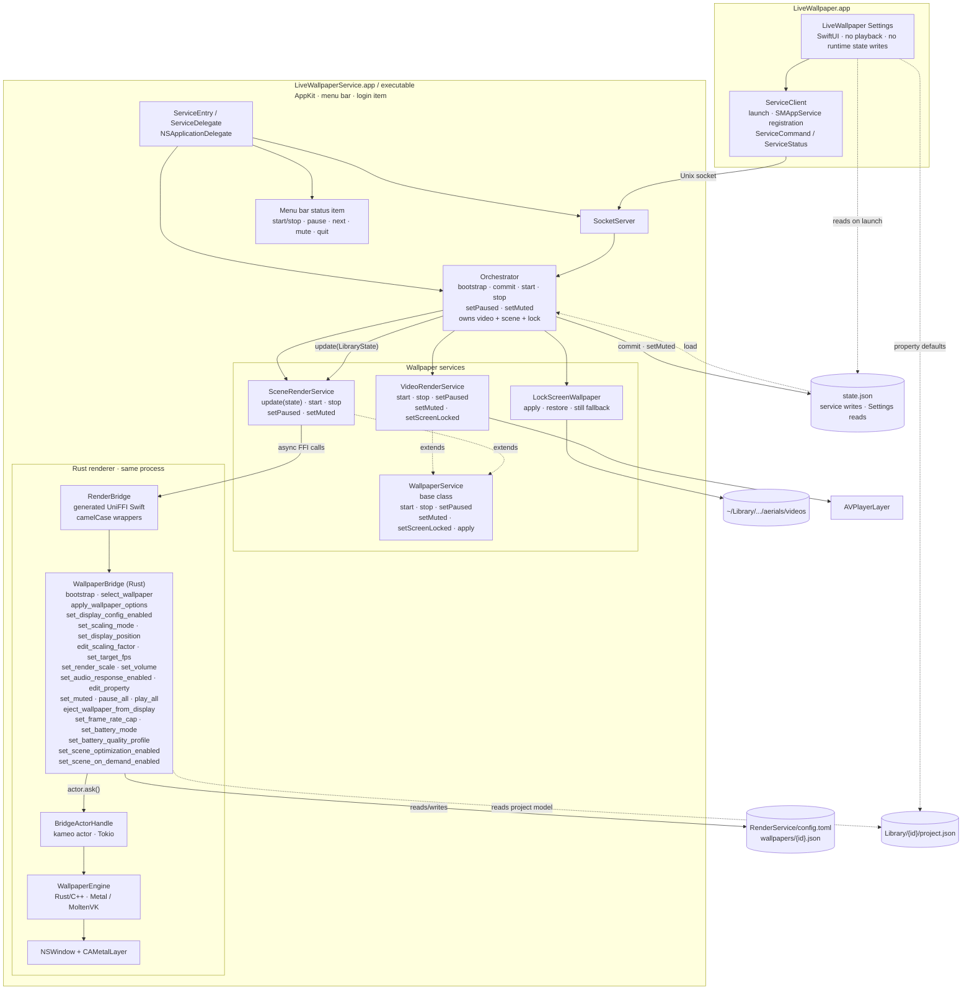

# Architecture

Live Wallpaper is one app bundle with two running processes:

- **LiveWallpaper.app** — the SwiftUI Settings app. It reads the library, edits settings, drives Steam Workshop downloads and sends commands to the service. It never plays a wallpaper and, after the one-time schema migration described below, never writes `state.json`.
- **LiveWallpaperService.app** — the nested AppKit background service at `Contents/Library/LoginItems/`. It owns playback, the lock screen, rotation timers, the menu bar item, the Unix socket and `state.json`.

The Rust/C++ scene renderer is statically linked into the service and accessed in-process through UniFFI. There is no scene-host process, no XPC service and no per-scene subprocess.

## Combined diagram

The outer graph is vertical; the app, playback services and renderer use horizontal layout. This is one diagram rather than separate process, class and Rust diagrams.



## Processes and IPC

Settings starts the nested service with `NSWorkspace.openApplication` when nothing answers on the socket, and registers it as an `SMAppService` login item. The service also enforces a single running instance: if a live service answers on the socket, a second copy exits.

The transport is a Unix domain socket, not NSXPC or launchd:

- Preferred path: `~/Library/Application Support/LiveWallpaper/service.sock`.
- Fallback when the path exceeds `sockaddr_un.sun_path`: `/tmp/lw-<uid>/service.sock`.
- Socket permissions are `0600`.
- Each message is a 4-byte big-endian length followed by JSON for `ServiceEnvelope`.
- The envelope carries a `ServiceCommand` or `ServiceStatus` payload encoded as JSON, so adding a command does not change the framing.
- One connection thread reads commands per client; commands are dispatched on the main actor; connected clients receive status pushes.

NSXPC was not used because launchd would not spawn the ad-hoc-signed nested service (`spawn failed, EX_CONFIG`). The custom socket avoids that requirement.

### State ownership

| File | Owner | Purpose |
|---|---|---|
| `state.json` | Service (normal operation) | Library, selections, rotation, scene options and power settings. Settings reads it and sends `.commit`. |
| `agent.json` | Service | Resume state, Aerial backup records and lock-screen restore state. |
| `RenderService/config.toml` | Renderer | Renderer-wide saved preferences, including scene quality settings. |
| `RenderService/wallpapers/{id}.json` | Renderer | Per-wallpaper renderer configuration. |
| `Library/{id}/project.json` | Workshop import / user library | Scene description read by both Settings and the renderer. |

There is one deliberate exception to “the service writes `state.json`”: when the Settings app upgrades a schema-1 file, `StateStore.loadOrMigrate` copies it to `state.v1-backup.json` and performs the one-time schema-2 rewrite before connecting to the service. After that, all commits go through the service.

## Service classes

`WallpaperService` is the playback base class:

```text
WallpaperService
  start(item)
  stop()
  setPaused(Bool)
  setMuted(Bool)
  setScreenLocked(Bool)
  apply(RenderOptions)
```

`VideoRenderService` extends it and overrides `start`, `stop`, `setPaused`, `setMuted` and `setScreenLocked`. It owns AVPlayer-backed windows and uses `AVPlayerLayer`.

`SceneRenderService` also extends it and overrides `start`, `stop`, `setPaused` and `setMuted`, and adds:

```text
update(LibraryState)
```

It does not use the base `apply` path for scene settings; it pushes only changed values to the Rust bridge. `setScreenLocked` is inherited from the base class as a no-op; the orchestrator calls it, but it has no effect for scenes. One scene runs at a time across all displays.

`LockScreenWallpaper` is separate from the playback hierarchy. It applies and restores Aerial files, and on macOS 15 produces a still image instead of a live video.

`Orchestrator` owns one `VideoRenderService`, one `SceneRenderService` and one `LockScreenWallpaper`, with separate desktop and lock-screen channels. It decides which service shows which item, handles rotation and failure fallback, and is the normal writer of `state.json`.

`ServiceDelegate` owns the socket server, the menu bar item and the orchestrator. Settings has no playback classes and never imports `RenderBridge`.

## Rust bridge

`RenderService/` is a copy of the WallpaperMachine renderer. The bridge crate produces `libwallpaper_bridge.a`; `scripts/build-render-service.sh` runs `uniffi-bindgen` to generate:

- `Sources/RenderBridge/WallpaperBridge.swift` — generated Swift API; do not hand-edit.
- `Sources/RenderBridge/FFI/WallpaperBridgeFFI.h` and `module.modulemap` — the SwiftPM system-library target.

The main Rust type is `WallpaperBridge` in `RenderService/crates/bridge/src/api/mod.rs`. Its exported methods include:

```text
bootstrap
select_wallpaper
apply_wallpaper_options
set_display_config_enabled
set_scaling_mode
set_display_position
edit_scaling_factor
set_target_fps
set_render_scale
set_volume
set_audio_response_enabled
edit_property
set_muted
pause_all
play_all
eject_wallpaper_from_display
set_frame_rate_cap
set_battery_mode
set_battery_quality_profile
set_scene_optimization_enabled
set_scene_on_demand_enabled
```

The bridge dispatches through `BridgeActorHandle` (a kameo actor). The engine below it owns the native windows and the scene/video render paths. `SceneRenderService` captures `VK_ICD_FILENAMES` for the bundled MoltenVK manifest when present, else falls back to Homebrew's manifest in a development build.

`VideoRenderService` currently uses AVPlayer rather than the renderer. The Rust renderer also has native video paths, but the Swift service has not switched to them.

## Scene options and state

`LibraryState` stores:

- `sceneOptions: [String: SceneOptions]` — per-scene fit, zoom, pan, render scale, FPS override, volume, audio response and property overrides, keyed by the Swift item UUID.
- `power: PowerOptions` — global frame-rate cap, battery mode, battery render scale/FPS, `skipRepeatedFrames` and `renderOnlyOnChange`.

`SceneRenderService.update` compares the new values with the last pushed values and calls only the changed bridge methods. Calls are chained so rapid edits keep their order, and every call uses `try?` so one refused setting does not stop the rest or the scene.

| UI / model | Rust bridge | Rust storage |
|---|---|---|
| Fit | `set_scaling_mode` | Display config / wallpaper config |
| Zoom | `edit_scaling_factor` | Display config |
| Pan | `set_display_position` | Display config framing |
| FPS | `set_target_fps` | Display config |
| Render scale | `set_render_scale` | Global renderer quality |
| Volume | `set_volume` | Wallpaper config |
| Audio response | `set_audio_response_enabled` | Wallpaper config |
| Scene properties | `edit_property`, `apply_wallpaper_options` | Wallpaper config |
| Mute | `set_muted` | Wallpaper config |
| Frame-rate cap | `set_frame_rate_cap` | Global quality |
| Battery rule | `set_battery_mode`, `set_battery_quality_profile` | Global quality |
| Skip repeated frames | `set_scene_optimization_enabled` | `quality.scene_optimization_enabled` |
| Update only when changed | `set_scene_on_demand_enabled` | `quality.scene_on_demand_enabled` |

`Skip repeated frames` is on by default. It enables static-subgraph caching and redundant copy-pass elimination; it changes how a frame is built, not the scene content, and applies live without restarting the scene. `Update only when the scene changes` is a separate opt-in: it stops the periodic tick when the renderer can prove nothing needs redrawing.

The Rust layer already exposes a richer `BridgeWallpaperOptionsSnapshot`:

- `properties` with id, kind, localized label, value, default, slider metadata, combo options, file/directory metadata, enabled state and asset status.
- `display_configurations` with display id, scaling mode, scale, framing, target FPS, maximum FPS, mute and volume.
- audio-response and media-integration flags.

Settings does **not** currently consume those property descriptors. `SceneProperty.load` reparses `Library/{id}/project.json` and supports only bool, slider, color, text and combo. File, directory, texture, groups, conditions and advanced asset handling remain unavailable in the Swift editor even though the Rust snapshot carries them.

Known mismatches:

- `renderScale` is stored per scene in Swift but is one global value in the Rust renderer.
- `antialiasing` is stored in `SceneOptions` but is not applied or exposed in the current Settings UI.
- All displays show the same scene; per-display scene assignments are not implemented in Settings.
- Scenes cannot be assigned to the lock screen.

## Build and packaging

Build order:

```sh
./scripts/install-render-deps.sh
./scripts/build-render-service.sh
./build.sh
```

The renderer build uses:

- `OWE_MACOSX_DEPLOYMENT_TARGET=15.0`; `MACOSX_DEPLOYMENT_TARGET` is unset so cargo's host proc-macro dylibs do not inherit it.
- Homebrew at `/opt/homebrew`, with the project-specific keg-only LGPL FFmpeg formula.
- The pinned Rust nightly and `aarch64-apple-darwin`.
- The generated static library and UniFFI bindings under `Sources/RenderBridge`.

`Package.swift` still declares macOS 13, and both `Resources/Info.plist` files still advertise `LSMinimumSystemVersion` 13.0. The renderer's 15.0 deployment target is why the documented minimum is macOS 15. Changing the plist values is a separate packaging change.

CI uses `macos-26` for both build and release. The renderer's C++ uses `std::jthread`, which needs libc++ 19+; `scripts/install-render-deps.sh` fails fast if the selected SDK is older. This is a build-toolchain requirement, not a runtime floor for the app. The release is arm64-only because the renderer static library and its Homebrew dependencies are arm64.

`build.sh` assembles the Settings app, nests the service under `Contents/Library/LoginItems/`, copies the service's non-system dylibs and MoltenVK into `Contents/Frameworks`, writes the MoltenVK ICD manifest, and signs inner bundles before the outer app. The guards reject SwiftUI or the old in-repo scene engine in the service, and the old scene engine in Settings; the service is expected to link Metal and `RenderBridge`.

## Limitations

- Scenes are desktop-only; the lock screen requires a video. There is no offline scene-to-video lock-screen render.
- Scene support is renderer-dependent; effects, particles, scripts or shared assets may be partial.
- The Swift scene property editor covers a subset of the Rust descriptors.
- Render scale is global in Rust although the app stores it per scene.
- Antialiasing is stored but not applied.
- All displays show the same scene.
- Video playback still uses AVPlayer windows, while scenes use the Rust renderer.
- The app is ad-hoc signed and not notarized.

## Licensing

The Swift app code is MIT-licensed under the root `LICENSE`. `RenderService/` is WallpaperMachine-derived and GPL-2.0-only under `RenderService/LICENSE`; `RenderService/SOURCE.txt` records the upstream commit and provenance. The combined distributed app must satisfy the GPL-2.0 terms for the linked renderer.
