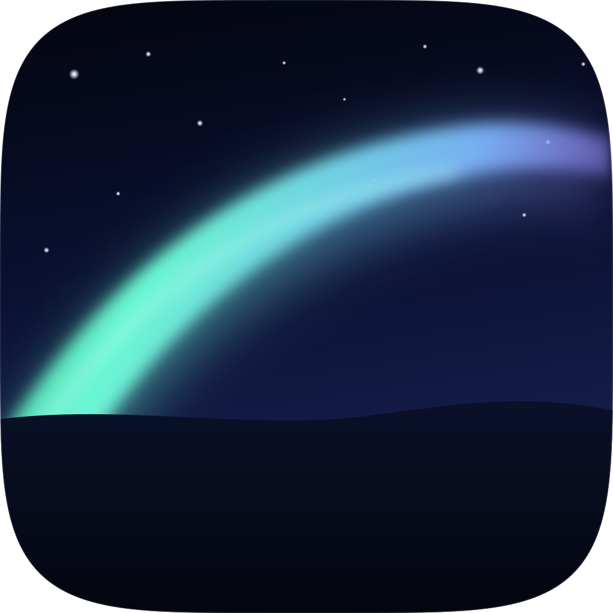

# Live Wallpaper



A macOS app that plays videos and Wallpaper Engine scenes as a desktop wallpaper, can rotate through several wallpapers on a timer, and can play a video on the lock screen on macOS 26 or later. Wallpapers can come from your Mac or from the Steam Workshop for Wallpaper Engine.

Live Wallpaper is split into two processes:

- **LiveWallpaper** (Settings): a SwiftUI window for the library, scene settings, rotation, Steam sign-in and Workshop downloads. It plays nothing; during normal operation the service is the only writer of `state.json`, and Settings reads state and sends commands to the service.
- **LiveWallpaperService**: a nested AppKit background app with a menu bar item. It owns playback, the lock screen, rotation timers, the Unix socket and `state.json`. It keeps running when the Settings window closes.

The scene renderer is linked into `LiveWallpaperService`; it is not a separate scene-host process.

## Install

1. Download `LiveWallpaper-<version>.dmg` from the [Releases](../../releases) page. Optional: check it with `shasum -a 256 -c LiveWallpaper-<version>.dmg.sha256` in the same folder.
2. Open the DMG and drag **LiveWallpaper** onto the **Applications** shortcut.
3. First launch. The app is signed ad hoc and **not notarized** (there is no paid Apple Developer account behind this project), so macOS blocks a downloaded copy the first time. Do one of these once:
   - Try to open it, then go to **System Settings > Privacy & Security**, scroll to the message about "LiveWallpaper", and press **Open Anyway**.
   - Or, in Terminal: `xattr -dr com.apple.quarantine /Applications/LiveWallpaper.app` (this also covers the nested service).
4. macOS may ask for access to your Desktop, Documents or Downloads folder, once for the Settings app and once for the background service (the service is what reads your videos and scenes).


## Usage

- Add videos by dropping them on the window or with Add Videos (⌘O). The first item is selected automatically.
- The preview shows the selected item, muted and looping.
- **Set as Desktop**, **Set as Lock Screen** or **Set as Both** assigns the selected item. Scenes can only be used on the Desktop; the lock screen needs a video.
- Rotation cycles through the playlist, or the library when no playlist is set, in list order. Set how often it switches (minimum 5 seconds). Rotation needs at least two wallpapers.
- **Same for both** (on by default) shares the selection and rotation settings between Desktop and Lock Screen. Turn it off to configure them separately.
- **Start Wallpaper** (⌘↩) starts the service if needed and begins playback. **Stop Wallpaper** ends playback and restores your original wallpapers.
- The service's menu bar item offers Open Settings, Start/Stop, Pause/Resume, Next Desktop Wallpaper, Next Lock Screen Wallpaper, Mute and Quit.
- Closing the Settings window quits Settings; the service keeps playing. Choosing Quit Wallpaper restores Apple's wallpapers and stops the service.

Everything the app installs stays in `~/Library/Application Support/LiveWallpaper/` and `~/Library/Caches/LiveWallpaperSteam/`. Remove the app and those folders to uninstall; choose **Quit Wallpaper** in the menu bar first so Apple's original wallpapers are restored.

## Requirements

- macOS 15 or later on Apple silicon.
- Live lock-screen video on macOS 26 or later. On macOS 15 the lock screen uses a still frame of the current video instead.
- To build from source: macOS 26 with Xcode 26 or matching Command Line Tools (libc++ 19+), Rust stable (our scene renderer) and nightly (the old render service), and Homebrew at `/opt/homebrew`.

The release build is arm64-only. The renderer and its Homebrew dependencies are arm64; universal builds are not supported.

## Build and run

```sh
./scripts/install-render-deps.sh
./scripts/build-render-service.sh
./scripts/build-scene-renderer.sh
./build.sh
open build/LiveWallpaper.app
```

`install-render-deps.sh` installs the Homebrew libraries, the project-specific LGPL FFmpeg formula and the pinned Rust toolchain. `build-render-service.sh` builds the old Rust renderer and regenerates the UniFFI Swift bindings in `Sources/RenderBridge`. `build-scene-renderer.sh` builds our own Rust renderer (`SceneRenderer/target/release/libscene_renderer.a`) and regenerates the bindings in `Sources/SceneBridge`; it needs a Rust stable toolchain and no Docker. `build.sh` calls it automatically, then builds the two Swift products and assembles `build/LiveWallpaper.app` with `LiveWallpaperService.app` nested at `Contents/Library/LoginItems/`, and signs both ad hoc.

Run the app through the `.app` bundle. `swift run` does not work, because both products need their `Info.plist`.

Useful options:

- `CONFIG=debug ./build.sh` builds a debug variant.
- `VERSION=1.2.3 BUILD_NUMBER=45 ./build.sh` stamps a version into both bundles.
- `swift test` runs the Core and SceneFormat tests after the renderer has been built.

The build checks that Settings never links the old scene engine and that the service never links SwiftUI or the old in-repo scene engine. The service does link Metal and `RenderBridge` for scenes.

`scripts/make-dmg.sh build/LiveWallpaper.app 1.2.3` packs the app into `dist/LiveWallpaper-1.2.3.dmg` with an Applications shortcut and a SHA-256 file. Pushing a tag such as `v1.2.3` runs the `release` workflow on a macOS 26 runner and attaches the DMG to a GitHub Release.


## Architecture

Live Wallpaper has two processes: the SwiftUI Settings app and the nested background service. The service owns playback, the lock screen, `state.json` and the Unix socket. Settings talks to it over that socket and never imports `RenderBridge`. The Rust/C++ scene renderer is statically linked into the service, not a separate process.

See [ARCHITECTURE.md](ARCHITECTURE.md) for the combined process, class, IPC and Rust bridge diagram, state ownership, scene-option mapping and build details.

## Steam Workshop (Wallpaper Engine)

The Workshop tab looks up items by link or item number and can browse with a Steam Web API key. Downloads use Valve's official SteamCMD with **your own Steam account, which must own Wallpaper Engine**. Nothing is downloaded anonymously, through shared accounts or through third-party download services, and nothing from Wallpaper Engine is bundled with or redistributed by this app.

The Steam Setup tab is the in-app wizard:

1. It downloads SteamCMD from Valve into the app's own folder. SteamCMD is never bundled because Valve's license does not allow redistributing it. The app checks which architecture the tool is built for and only mentions Rosetta if the tool is Intel-only and Rosetta is missing.
2. Sign in with your Steam username, password and Steam Guard code if asked. They are handed to SteamCMD through a pseudo-terminal and are not stored, logged or placed on a command line. SteamCMD keeps its own login token; **Sign out** removes it.
3. The app checks that the account owns Wallpaper Engine.

Click a Workshop result to see its preview, tags, size and description, then Download. Video wallpapers (MP4, MOV, M4V) play directly. Scene wallpapers use the bundled renderer. Web and application wallpapers, and video formats macOS cannot decode, are shown as unsupported and are never converted. Workshop items belong to their creators: they are downloaded for your personal use on this Mac, through your own account. Do not redistribute them. This app is not affiliated with Valve or Wallpaper Engine.

## Scenes

Scenes are Wallpaper Engine wallpapers with layers, effects, particles and sound. They are drawn by the bundled renderer derived from [WallpaperMachine](https://github.com/WallpaperMachine/WallpaperMachine), not by an in-repo MIT scene engine. The renderer is GPL-2.0-only; see `RenderService/SOURCE.txt` and `RenderService/LICENSE`.

Scenes can be the **desktop** wallpaper only. The lock screen needs a video, so a scene cannot be assigned to the lock screen and is not rendered offline into a video. All displays show the same live scene.

Scene support depends on the renderer. The library badge reports **Full**, **Partial** or **Preview only**; partial scenes may ignore unsupported effects, particles, sounds or scripts. Some scenes need Wallpaper Engine's shared asset files, which can be fetched with your own account in Steam Setup.

Scene settings include fit, zoom, pan, frame rate, render scale, volume, audio response and the scene's own user properties. Power settings include a frame-rate cap, battery behavior, **Skip repeated frames** and **Update only when the scene changes**. The property editor currently supports bool, slider, color, text and combo properties; file, directory and other advanced property types are not yet exposed in Settings. Antialiasing is stored but not applied or exposed in Settings yet.

## Desktop, lock screen and sound

Each library item has **Set as Desktop**, **Set as Lock Screen** and **Set as Both**, and shows a badge for where it is used. **Same for both** in Settings keeps one wallpaper, one rotation list and one interval for both; turn it off to give the lock screen its own configuration. **Mute** (on by default) is in Settings and in the service's menu bar menu; the lock screen never has sound.

## Lock screen

On macOS 26 (Tahoe) and later the lock screen plays your video. macOS has no public API for that, so the service borrows the slot of an Apple Aerial wallpaper: Apple stores downloaded Aerial videos as `.mov` files in `~/Library/Application Support/com.apple.wallpaper/aerials/videos/`, and the service swaps your video into all of them. The system then plays it on the lock screen as if it were the Aerial. No admin rights or SIP changes are needed, and everything stays inside your user folder.

One-time setup: open System Settings > Wallpaper, pick any Apple Aerial, wait for it to download and leave it selected. Without a downloaded Aerial the service reports an error instead of applying the lock screen.

The service can't tell which downloaded Aerial the lock screen plays, and each display or Space can use a different one, so it replaces every downloaded Aerial with your video. The extra copies are hard links, so they normally take no additional disk space. Apple's Aerial screen saver shows your video too while the service runs.

- Apple's original files are moved to `~/Library/Application Support/LiveWallpaper/Backups/` before the first swap. Stop and Quit Wallpaper move them back. After a crash they are moved back the next time the service launches without resuming playback, or on Stop.
- Your video is converted without audio and repeated end to end until it lasts about 3 minutes, because the renderer misbehaves when a video ends. The converted file normally keeps the source encoding and can be large, since the repeats add up.
- Rotation updates the lock screen at most every 30 seconds, always ending on the latest video. The desktop switches at your chosen interval.
- The service restarts the wallpaper renderer each time you unlock the screen, which keeps later lock screens from going black. It never does this while the screen is locked.
- The first lock after switching videos may briefly show the previous frame.
- The FileVault login screen shown after a cold boot stays static, because it appears before your session exists.
- A macOS update may put Apple's own Aerial back. Stop and start the wallpaper to install your video again.
- On macOS 15 the lock screen gets a still frame of the current video as the system wallpaper instead.

## Upgrading

Replace the app bundle. The library file is upgraded to schema 2 on the first launch of the new Settings app (a copy of the old one stays next to it as `state.v1-backup.json`); nothing in your library changes. Quit Wallpaper in the menu bar before replacing the app so an older service does not keep running. Do not run old and new copies together.

## Files

Everything lives in `~/Library/Application Support/LiveWallpaper/`:

- `state.json`: library and settings. The service writes it during normal operation; Settings reads it and sends `.commit` over the socket. On first launch, Settings may rewrite a schema-1 file once during migration, keeping `state.v1-backup.json`.
- `agent.json`: playback and lock-screen restore state, written by the service.
- `Library/<id>/`: a downloaded Workshop item, imported local scene, preview and related files.
- `Backups/` and `Stills/`: Apple Aerial backups and lock-screen stills.
- `SteamCMD/` and `SteamHome/`: the Steam tool and its login token.
- `WallpaperEngineAssets/`: optional shared Wallpaper Engine assets.
- `RenderService/config.toml` and `RenderService/wallpapers/<id>.json`: the renderer's own saved settings.
- `service.sock`: the Unix socket used by Settings and the service, when the path fits. Otherwise the service uses `/tmp/lw-<uid>/service.sock`.

Steam downloads are staged in `~/Library/Caches/LiveWallpaperSteam/`.

## Permissions and Gatekeeper

The app and the nested service are signed ad hoc, not notarized (see Install above). If macOS refuses to open a downloaded or copied build, clear the quarantine flag on the whole bundle (this includes the nested service):

```sh
xattr -dr com.apple.quarantine /Applications/LiveWallpaper.app
```

Because the signature is ad hoc, macOS may ask again for access to folders such as Desktop, Documents, Downloads or removable volumes after each rebuild, once for Settings and once for the service (the service is what reads your videos and scenes).

## Performance

Prefer H.264 or HEVC videos at or near your screen resolution. Higher resolutions and exotic codecs use more CPU and battery. The service pauses video playback when the desktop is fully covered and while the display sleeps, and releases GPU memory when possible.

A playing scene costs more GPU time and memory than a video. Scenes run inside the service, not in a separate scene host, and all displays show the same scene. The battery rule defaults to reduced quality (lower render scale and 24 fps); **Skip repeated frames** is on by default, and **Update only when the scene changes** can stop an idle scene's periodic tick. Antialiasing is not applied yet.

## Credits and license

The Swift app code in this repository is MIT-licensed; see `LICENSE`. The scene renderer under `RenderService/` is derived from WallpaperMachine and is **GPL-2.0-only**; see `RenderService/LICENSE` and `RenderService/SOURCE.txt`. Distributing the combined app therefore also has to satisfy the renderer's GPL-2.0 terms.

This app is an independent implementation and is not affiliated with Apple, Valve or Wallpaper Engine. Ideas and format knowledge came from these projects:

- [vlzuiev/animated](https://github.com/vlzuiev/animated) (MIT): the lock screen technique of swapping a converted video into an Apple Aerial slot.
- [MozeeB/OpenWallpaperMac](https://github.com/MozeeB/OpenWallpaperMac) (MIT): reference for scene wallpaper structure on macOS.
- [WallpaperMachine](https://github.com/WallpaperMachine/WallpaperMachine): the source of the Rust/C++ scene renderer in `RenderService/`.
- [Almamu/linux-wallpaperengine](https://github.com/Almamu/linux-wallpaperengine) (GPL-3.0), [deepratna-awale/open-wallpaper-engine-mac](https://github.com/deepratna-awale/open-wallpaper-engine-mac) (GPL-3.0) and [ayasa520/wallpaper-scene-renderer](https://github.com/ayasa520/wallpaper-scene-renderer): existing scene renderers studied for how Wallpaper Engine scenes work.
- [kageroumado/phosphene](https://github.com/kageroumado/phosphene) (MIT): considered as an alternative lock screen approach.
- [notscuffed/repkg](https://github.com/notscuffed/repkg) (MIT): read for the layout of the `.pkg` and `.tex` formats; no code is copied.
- The Wallpaper Engine designer documentation (docs.wallpaperengine.io) for what scene features exist.

## Possible future extras

- Shuffle order
- Per-display scene assignments
- More scene property types and effects support
- App Sandbox support (needs security-scoped bookmarks for the chosen videos)
